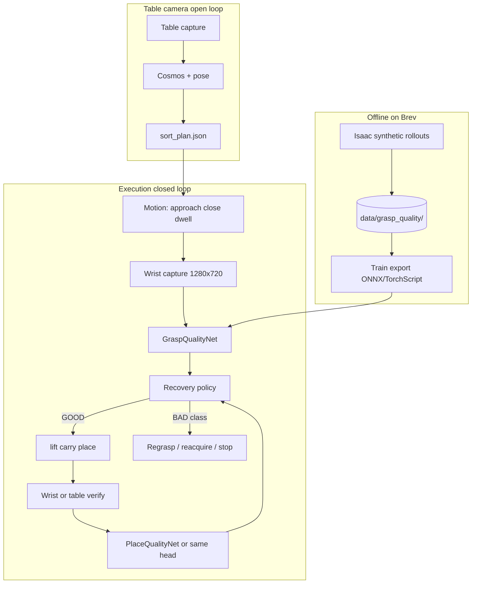
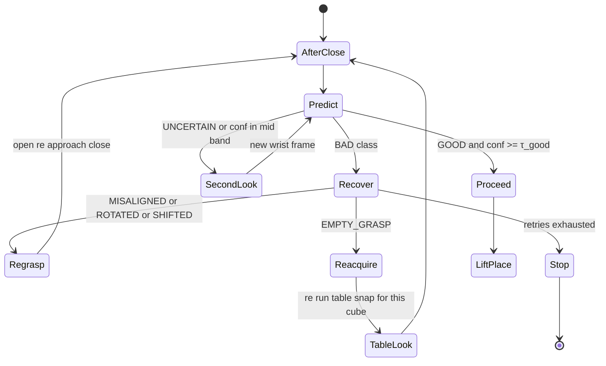

# Vision-Guided Closed-Loop Manipulation with AI-Based Grasp Verification

**Research question:** Can a learned wrist-camera grasp-quality classifier improve tower completion by detecting failed or unstable grasps and triggering recovery?

**Constraint:** One month, seven people, limited lab access (≈2 supervised FANUC sessions). Isaac Sim + Cosmos starter unchanged for **table** perception; wrist model is the new AI contribution.

---

## 1. System architecture



**Design principles**

- **Single contract at runtime:** `predict_grasp_quality(image_bgr) -> {class, confidence}` (and optional `yaw_prior` only as a feature, not as the decision engine).
- **Recovery policy stays deterministic** and object-size-aware; the ML model only supplies class + confidence. Judges see both ablation (rules vs AI) and interpretable actions.
- **Never use sim ground-truth poses to label at runtime**; labels come from logged physics events during data generation only.

---

## 2. Classification: Option A vs Option B

| | Option A (GOOD / BAD) | Option B (multi-class) |
|--|------------------------|-------------------------|
| Training | Easier, more data per class | Harder, needs balanced sampling |
| Recovery | One regrasp strategy | **Class-specific** actions (reacquire vs regrasp vs replace) |
| Metrics | Weak for paper/video | **False positives/negatives per failure mode** |
| Competition story | “We added AI” | “We classify *why* it failed and recover accordingly” |

**Recommendation: Option B (multi-class), with a collapsed policy map.**

**Model classes (7):**

| Class | Meaning | Typical cause in sim |
|-------|---------|----------------------|
| `GOOD` | Cube seated, grasp stable | Nominal close |
| `EMPTY_GRASP` | No cube in jaws | Miss, slip off table |
| `MISALIGNED` | Cube present but off-center / edge contact | XY error |
| `ROTATED` | Cube yaw exceeds jaw opening | Yaw error |
| `SHIFTED` | Partial capture / slipping during close | Low friction |
| `PLACEMENT_FAILURE` | Used on post-release frame | Bad stack |
| `UNCERTAIN` | Low margin / OOD | Blur, glare, partial occlusion |

**Policy uses full class; benchmark reports per-class precision/recall.**  
If training stalls in week 2, **fallback:** train binary GOOD vs BAD but log “BAD subtype” from sim metadata for analysis only (do not claim multi-class recovery until the head is deployed).

**Why not pure binary:** Empty grasp vs misaligned needs **reacquire** (table look) vs **local regrasp**; judges and the business case care about *failure mode*, not just “bad.”

---

## 3. Model requirements and recommendation

**Candidates (224×224 input, ImageNet init where noted):**

| Model | Params | GPU latency (est.) | CPU latency (est.) | Size | Notes |
|-------|--------|--------------------|--------------------|------|--------|
| Custom CNN (4–5 conv) | ~0.5M | &lt;5 ms | 15–30 ms | &lt;2 MB | Fastest deploy; needs more sim data |
| **MobileNetV3-Small** | ~2.5M | **8–15 ms** | **25–45 ms** | ~3 MB | **Recommended default** |
| EfficientNet-B0 | ~5M | 15–25 ms | 50–80 ms | ~6 MB | Best accuracy; tight on CPU budget |
| ResNet18 | ~11M | 10–20 ms | 40–70 ms | ~45 MB | Overkill for 1280×720 crop |

**Recommendation:** **MobileNetV3-Small** (torchvision), exported **TorchScript or ONNX** for a fixed 224×224 wrist ROI crop. Target **&lt;50 ms** on lab PC GPU; on-robot edge not required for hackathon (check runs on same machine as Isaac or a sidecar Python process).

**Secondary baseline:** same architecture trained on **hand-crafted pseudo-labels** from current `grasp_check.py` rules on sim frames (proves “learning beats rules” on identical images).

**Place verification:** Start with **same backbone, second head** (multi-task) or duplicate model fine-tuned on post-`settle` frames labeled `GOOD` vs `PLACEMENT_FAILURE` vs `UNCERTAIN`. One model with two heads reduces deployment complexity.

---

## 4. Synthetic data generation (Isaac Sim)

### 4.1 Label source (automatic, no human labelers)

During scripted rollouts, log **weak labels from physics + geometry** (allowed only in data gen):

| Label | Rule (example) |
|-------|------------------|
| `GOOD` | Tracked cube in jaws; COM within ROI; yaw &lt; 12°; pickup_verified after micro-lift |
| `EMPTY_GRASP` | No object lifted; jaw gap near closed; no cube blob in ROI |
| `ROTATED` | Cube in contact but yaw &gt; 13° |
| `MISALIGNED` | Cube contact; COM offset &gt; 2 mm from grasp center |
| `SHIFTED` | Partial lift &lt; 25 mm or slip event |
| `PLACEMENT_FAILURE` | Post-settle; stack support check fails |
| `UNCERTAIN` | Conflicting signals or borderline (e.g. 11–13° yaw) — **≤10% of set** |

Capture **one wrist PNG per label event** at `dwell` (grasp) or `settle` (place).

### 4.2 Randomization

- Cube XY, yaw (0–45°), stack level  
- `tip_static_friction` ∈ [0.6, 1.5]  
- Pick XY/yaw **command offsets** (same as `configs/trials/`)  
- Table/wrist exposure ±15%, Gaussian noise σ=3–8  
- Optional cap near cube (occlusion) in 10% of frames  

**Target volume:** **8k–15k grasp images**, **2k–4k place images** (achievable in ~20–40 GPU-hours batched headless).

### 4.3 Dataset layout

```
data/grasp_quality/
  manifest.json          # paths, labels, seed, trial_id, sim metrics
  images/
    train/ GOOD/ *.png
    train/ EMPTY_GRASP/ ...
    val/ ...
    test/ ...            # held-out seeds only
  meta/
    label_counts.json
    sim_version.txt
```

**Splits:** **By seed**, not by image: 70% train / 15% val / 15% test seeds. All conditions (nominal, yaw, friction, …) in each split.

**Augmentation (train only):** Color jitter, Gaussian blur, JPEG compression, random crop ±5% on ROI, horizontal flip **only if symmetric in jaw frame** (usually **no flip** — wrist mount fixed).

### 4.4 Pipeline scripts (to implement)

| Script | Role |
|--------|------|
| `scripts/sim/collect_wrist_dataset.py` | Isaac: loop trials, save PNG + JSONL label |
| `scripts/train_grasp_classifier.py` | Train, val metrics, export `models/grasp_quality_mobilenet_v3.pt` |
| `scripts/eval_grasp_classifier.py` | Confusion matrix, latency bench |

Hook: extend `sort_scene.py` `--collect-dataset` mode (no full video) for throughput.

---

## 5. Recovery policy

### 5.1 Inputs

```python
Prediction = { "class": str, "confidence": float }  # softmax max prob
```

**Thresholds:** `τ_good = 0.75`, `τ_act = 0.55`. Below `τ_act` → treat as `UNCERTAIN`.

### 5.2 State machine (grasp phase)



### 5.3 Pseudocode

```text
MAX_GRASP_RETRIES = 2
MAX_PLACE_RETRIES = 1
MAX_UNCERTAIN_LOOKS = 1

after_close(wrist_img):
    for attempt in 0..MAX_GRASP_RETRIES:
        pred = model(wrist_img)
        if pred.class == GOOD and pred.confidence >= τ_good:
            return PROCEED
        if pred.class == UNCERTAIN and uncertain_looks < MAX_UNCERTAIN_LOOKS:
            wrist_img = capture_wrist(); uncertain_looks++; continue
        if pred.class == EMPTY_GRASP:
            reacquire_table_pose(); continue
        if pred.class in {MISALIGNED, ROTATED, SHIFTED}:
            open_gripper(); re_approach(); continue
        if attempt == MAX_GRASP_RETRIES:
            return SAFE_STOP(pred.class)
    return SAFE_STOP

after_place(verify_img):
    pred = place_model(verify_img)  # or second head
    if pred.class == GOOD: return PROCEED
    if pred.class == PLACEMENT_FAILURE and place_attempt < MAX_PLACE_RETRIES:
        return REGRASP_PICK
    return SAFE_STOP
```

Log every step to `manipulation.jsonl` (class, confidence, action).

---

## 6. Scalability stretch: YOLO front-end

| Question | Answer |
|----------|--------|
| Worth it in month 1? | **Only after** AI grasp model + 3-way benchmark frozen (~Oct 29). **Low priority** vs sim dataset + real demo. |
| Train vs transfer? | **Transfer:** YOLOv8n/YOLO11n pretrained on COCO; fine-tune on **sim-only** cubes/caps/tubes. Full train from scratch is not worth it. |
| Images needed? | **~500–1500** labeled sim table images for decent cube AP; caps/tubes harder — **300/class** minimum for a demo clip. |
| Judging impact | **Medium** if you show one video: “same recovery, YOLO proposes grasp.” **High risk** if YOLO steals week 3 from lab video and confusion matrix. |
| Recommendation | Document in one-pager as **future work** unless grasp AI + hardware demo done by Oct 28. Keep YOLO in `stretch/yolo/` only. |

**Claim (when demonstrated):** Table planner is pluggable; recovery consumes **any** grasp target + wrist verification.

---

## 7. Benchmarking (three systems)

| System | Description |
|--------|-------------|
| **Baseline** | Starter open loop, no wrist checks |
| **Rules** | Current `grasp_check.py` heuristics + same recovery limits |
| **AI** | MobileNetV3 multi-class + same recovery map |

**Metrics (same `configs/trials/` seeds):**

- First-grasp success (physics `pickup_verified` on first close)  
- Tower completion (`task_complete`)  
- Recovery success (failed first close → eventual placement)  
- **FP rate:** GOOD when physics miss  
- **FN rate:** BAD/UNCERTAIN when physics good  
- Mean retries, mean cycle time  
- Residual failures by class  

**Reporting:** One table in `results/benchmarks/summary.md` + confusion matrix figure for AI on **held-out test seeds**.

**Do not** tune thresholds on test seeds.

---

## 8. Real hardware plan

| Topic | Plan |
|-------|------|
| Sim-to-real gap | Texture, exposure, motion blur, finger wear; expect **5–15% accuracy drop** |
| Calibration | Wrist ROI crop uses **fixed normalized ROI** first; visit 1: collect 50 frames → adjust ROI in config, not retrain entire sim |
| Collection | Supervised session: 20 open-loop + 20 closed-loop picks; save wrist PNG + `execution_report.json` |
| Labeling | **Human spot-check 100 frames** for test set only; train remains sim |
| Retraining | **Fine-tune last layer** on 200–500 real labeled frames if time; else show sim-trained with honest gap |
| Demo | Show **one** recovery on real arm; show FP/FN discussion |

---

## 9. Repository structure (additions)

```
src/stacking_recovery/
  vision/
    grasp_check.py          # rules (benchmark arm)
    grasp_quality_model.py  # AI inference wrapper
  control/
    recovery_policy.py      # class → action map
  bench/
    metrics.py              # + FP/FN vs physics
data/grasp_quality/         # gitignore images; commit manifest samples
models/                     # gitignore *.pt; commit export instructions
configs/
  grasp_model.yaml          # paths, τ, ROI, class list
scripts/
  sim/collect_wrist_dataset.py
  train_grasp_classifier.py
  eval_grasp_classifier.py
docs/
  AI_GRASP_VERIFICATION_DESIGN.md  # this file
```

Existing `sort_scene.py` flags: `--closed-loop rules|ai`, `--collect-dataset`.

---

## 10. Risk assessment

| Risk | Mitigation |
|------|------------|
| Dataset gen too slow | Headless physics-only; cap at 8k; class-balanced sampling |
| Model overfits sim | Seed-held-out test; domain rand (noise/light) |
| Rules beat AI on sim | Still win with **real-arm** clip + FN analysis; tune ROI not rules |
| Wrist occluded | UNCERTAIN + second look; document limit |
| Team blocked on Isaac | Rules path + host tests ship week 1; AI parallel on Brev |
| Lab cancelled | Sim benchmark + “pending hardware” in one-pager |

---

## 11. Three-week schedule

| Week | Dates | Milestones |
|------|-------|------------|
| **1** | Oct 14–19 | Rules closed-loop stable; `collect_wrist_dataset` v0 (1k imgs); train MobileNet baseline; unit tests green |
| **2** | Oct 20–26 | Full 8k dataset; multi-class model; `--closed-loop ai` in sim; **lab visit 1** (wrist dumps); rules vs AI table on core seeds |
| **3** | Oct 27–Nov 1 | Freeze models Oct 29; optional real fine-tune; **lab visit 2** video; 3-way benchmark; one-pager + confusion matrix |

---

## 12. Team assignments (7 people, by skill)

| Role | Focus |
|------|--------|
| **Lead / integrator** | Contracts, `sort_scene` flags, merges, benchmark freeze |
| **ML engineer A** | Dataset schema, training, export, latency bench |
| **ML engineer B** | Isaac collection script, label logic, augmentation |
| **Robotics / sim** | Trial matrix, physics labels, `run_benchmark` |
| **Recovery / control** | State machine, JSONL, rules baseline |
| **CAD / finger** | Optional pad; not on critical path for AI |
| **Submission / lab** | Visits, video, one-pager, overlay visuals |

Two strongest coders: **ML A + integrator**. Two moderate: **ML B + robotics**.

---

## 13. Competition differentiators

1. **Clear research question** with ablation: baseline → rules → **learned** wrist verification.  
2. **Multi-class failure taxonomy** tied to industrial recovery (not black-box “AI fixed it”).  
3. **Synthetic data pipeline** in Isaac (NVIDIA-aligned story).  
4. **Measured FP/FN** and honest tilt/occlusion failures.  
5. **Real FANUC clip** with recovery + logged class/confidence overlay.  
6. **Pluggable perception** sentence (YOLO only if demo exists).

---

## 14. Immediate next steps (implementation order)

1. Add `configs/grasp_model.yaml` and `GraspQualityPrediction` type mirroring `{class, confidence}`.  
2. Implement Isaac `collect_wrist_dataset.py` with physics labels.  
3. Train MobileNetV3-Small; wire `grasp_quality_model.py` into `recovery_policy` behind `--closed-loop ai`.  
4. Extend `metrics.py` for FP/FN vs `pickup_verified`.  
5. Run 3-way benchmark on nominal + yaw + friction seeds before expanding matrix.

---

*Related:* [ARCHITECTURE.md](ARCHITECTURE.md), [CONTRIBUTING.md](CONTRIBUTING.md), starter [AGENTS.md](../data/fanuc_er4ia_hackathon_starter_v05%20(1)/fanuc_er4ia_sim/AGENTS.md).
