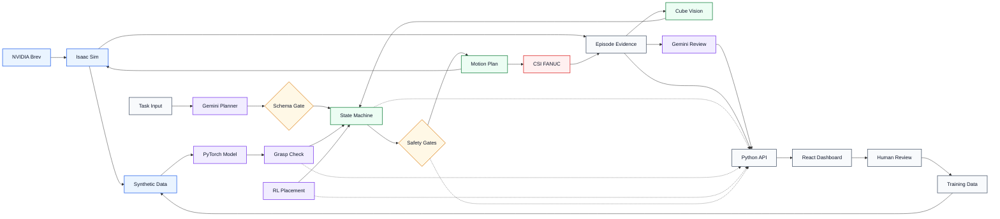
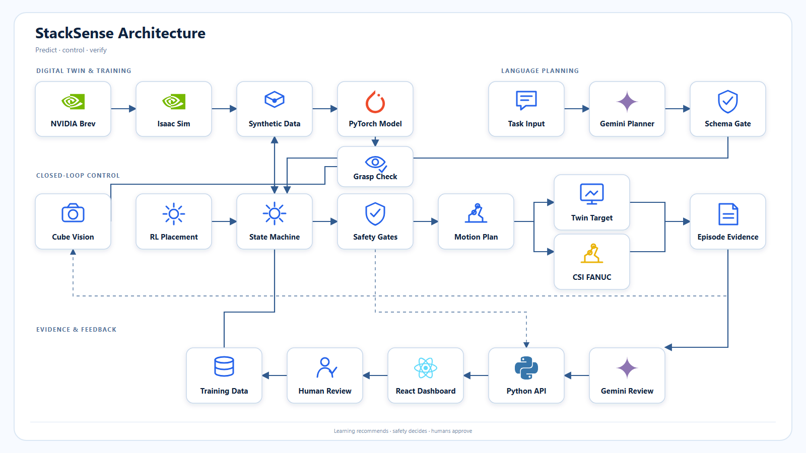

# Predictive Closed Loop Manipulation Architecture

Our system combines language-based task planning, learned visual verification,
deterministic robot control, bounded reinforcement learning, and continuous
telemetry. Learned components predict outcomes and recommend high-level
corrections; they never command robot joints or bypass the safety gates.

## System architecture

## Presentation diagram

[Open the PNG](architecture/stacksense_architecture.png) or
[open the editable SVG](architecture/stacksense_architecture.svg).

## How the components work together

We used the provided NVIDIA Brev credits to run the Isaac Sim digital twin,
generate repeatable successes and intentional failures, and train the Siamese
grasp verifier on before-and-after RGB image pairs. The selected checkpoint is
then loaded by the runtime verifier.

At runtime, a guarded instruction router first checks whether the request is a
known validated task. The red-on-blue and six-cube tower instructions use a
deterministic local parser, so physical execution does not depend on Gemini or
network availability. Flexible wording can use Gemini to produce strict
structured JSON, but its output must pass the same schema and allowlist gate.
Gemini can select only a tested high-level skill and object parameters; it
cannot generate coordinates, joint commands, trajectories, or executable code.
Ambiguous instructions, unsupported objects, unexpected fields, timeouts, and
network failures are rejected before motion begins.

After planning, table-camera perception locates the source and destination
objects, and the deterministic recovery state machine sequences the manipulation
steps. The Siamese model predicts whether the grasp succeeded, while the
safety-shielded Q-learning policy can propose only a small placement correction,
retry, or stop. Inverse kinematics, trajectory interpolation, workspace limits,
position tolerances, and retry limits remain authoritative.

The same safety-constrained state-machine path can target the Isaac Sim workcell
or the supervised CSI FANUC cell. The physical path adds a fail-closed preflight
that requires valid calibration and three stable six-cube detections before the
first command, then sends bounded TCP targets through the organizers' official
remote client. Online reinforcement learning is intentionally disabled on the
physical arm; only validated deterministic skills can command it.

Every task plan, prediction, preflight result, state transition, RL decision,
timing measurement, physical command, and verification result is sent one way
to the read-only dashboard API. The React and TypeScript dashboard synchronizes
those records with video so an operator can see what the system predicted, what
it decided, and whether the action succeeded.

## Repository map

| Path | Purpose |
| --- | --- |
| [`src/stacking_recovery/`](../src/stacking_recovery/) | Library: vision, recovery policy, metrics |
| [`configs/trials/`](../configs/trials/) | Perturbation + policy matrix |
| [`configs/finger/`](../configs/finger/) | Finger geometry params |
| [`scripts/`](../scripts/) | `run_benchmark.py`, `generate_trials.py`, `aggregate_results.py` |
| [`tests/`](../tests/) | Unit tests (no Isaac) |
| [`data/fixtures/`](../data/fixtures/) | Lab/sim wrist crops |
| [`results/`](../results/) | Sim runs and benchmark summary |
| [`data/.../fanuc_er4ia_sim/`](../data/fanuc_er4ia_hackathon_starter_v05%20(1)/fanuc_er4ia_sim/) | Vendor sim (`sort_scene.py` integration) |
| [`stretch/yolo/`](../stretch/yolo/) | Optional detector swap (after core ships) |

## Sim integration

- [`sort_scene.py`](../data/fanuc_er4ia_hackathon_starter_v05%20(1)/fanuc_er4ia_sim/sort_scene.py): `--closed-loop`, `--trial-config`
- [`run_sort_pipeline.sh`](../data/fanuc_er4ia_hackathon_starter_v05%20(1)/fanuc_er4ia_sim/run_sort_pipeline.sh): `CLOSED_LOOP=1`, `TRIAL_CONFIG=...`
- Logs: `manipulation.jsonl` in the run directory

## Contracts

- `grasp_check(image_bgr) -> GraspCheckResult` (`seat_check` alias)
- `place_check(image_bgr, stack_level) -> PlaceCheckResult`
- Schemas: [`configs/schemas/`](../configs/schemas/)
